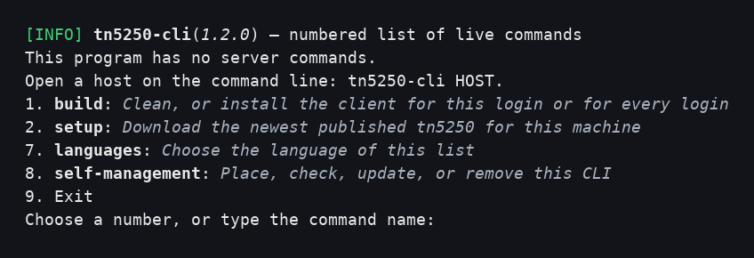
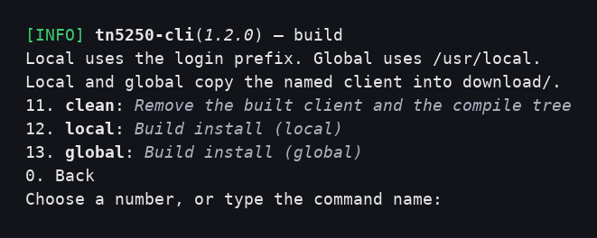
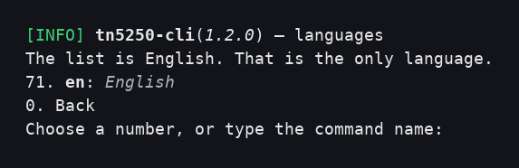
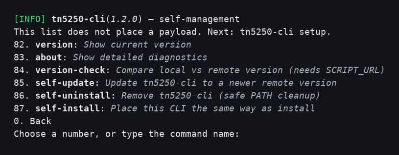

# tn5250-cli

[](https://github.com/cloudgen/tn5250-cli)
[](./LICENSE.md)
[-purple.svg)](https://github.com/cloudgen/ciao)
[](https://github.com/cloudgen/tn5250-cli)

`tn5250-cli` builds and opens tn5250, a free 5250 terminal client for IBM i. You type `tn5250-cli build local`, or you choose **1** on the numbered list and then **12**. On Debian, Ubuntu, other Linux, Alpine, Fedora, and Red Hat Enterprise Linux, missing compiler packages are installed with sudo from inside that command. On Alpine that install is `apk`. On Fedora and Red Hat Enterprise Linux that install is `dnf`. On Termux, the same command installs missing compiler packages with `pkg` as your user and does not call sudo. On macOS, the same command installs a missing formula with `brew` as your user and does not call sudo. Git and the compile stay with you, including when build was started with sudo on Linux.

## What tn5250 is

tn5250 is a terminal client for IBM i. IBM i is the operating system that ran on the AS/400 and the iSeries, and that still runs on IBM Power systems. A person reaches it through a 5250 session. The host draws the sign-on screen and the menus. The terminal sends the fields when you press Enter or a function key. That screen protocol, carried over Telnet, is the 5250 telnet protocol.

The client this installer builds is [tn5250/tn5250](https://github.com/tn5250/tn5250). On Debian, Ubuntu, other Linux, Alpine, Fedora, Red Hat Enterprise Linux, Termux, and macOS it runs in the current terminal, with curses, including the wide 27×132 screen and color where the terminal allows it. On Windows Git Bash it opens its own window. The same build also produces `lp5250d`, the printer session, and the SCS tools `scs2ascii`, `scs2pdf`, and `scs2ps`.

This repository is the installer. Its command name stays `tn5250-cli`, so the `tn5250` program on your PATH is the client. After build, `tn5250-cli HOST` opens a session on that IBM i host. The client keeps the upstream license. This installer is MIT.

## Features

- One build command for your user and for a sudo launch.
- Windows Git Bash builds the Windows programs.
- Debian 12 and 13, Ubuntu 22.04, 24.04, and 26.04, other Linux, Alpine, Fedora, Red Hat Enterprise Linux, Termux, and macOS build the curses program.
- The built client is copied under the install prefix. Local defaults to `~/.local`. Global defaults to `/usr/local`.
- Local and global also copy that client into `download/` under the published name.
- `help` and `version` print text and do not compile.

Build clones [tn5250/tn5250](https://github.com/tn5250/tn5250) tag `v0.18.0` at commit `cd5980177b9468763bcaa669bf5cacbe7de5ec63`.

## Quick Installation

Place this CLI, then build the terminal client with `tn5250-cli build`.

```sh
curl -fsSL https://raw.githubusercontent.com/cloudgen/tn5250-cli/main/src/tn5250-cli | sh
```

On Linux, a root login uses:

```sh
sudo curl -fsSL https://raw.githubusercontent.com/cloudgen/tn5250-cli/main/src/tn5250-cli | sudo sh
```

Git Bash uses the first command. Do not prefix that command with sudo.

`SCRIPT_URL` defaults to `https://raw.githubusercontent.com/cloudgen/tn5250-cli/main/src/tn5250-cli`. `REPO_USER` defaults to `cloudgen` and `REPO_NAME` defaults to `tn5250-cli`. Export `SCRIPT_URL` to use another script address. An empty `SCRIPT_URL` refuses the download.

The one-liner places `tn5250-cli` on your PATH (`~/.local/bin`, or `/usr/local/bin` for root). It does not compile the terminal client. Run `tn5250-cli build` after the CLI is on your PATH.

Install checks SHA-256 by downloading the companion itself. You do not set a pin. The companion is `src/tn5250-cli.sha256`, fetched as `https://raw.githubusercontent.com/cloudgen/tn5250-cli/main/src/tn5250-cli.sha256`. Human output shows the companion link, the expected digest, and the result.

| Result | What happens |
|--------|----------------|
| Match | The install continues. |
| Mismatch | The install stops. |
| Missing companion | The install warns and continues. |

An optional `CHECKSUM` environment value can pin a digest for a CI run. A mismatch stops the install. That pin is not the usual path.

From a checkout:

```sh
git clone git@github.com:cloudgen/tn5250-cli.git
cd tn5250-cli
src/tn5250-cli build
```

Build asks for the administrator password only when compiler packages are missing. If the compiler is already installed, build does not call sudo.

At a terminal, `tn5250-cli` with no command opens the numbered list. A pipe, `--quiet`, or `--json` places this CLI instead and does not wait.

```text
[INFO] **tn5250-cli**(*1.2.0*) — numbered list of live commands
This program has no server commands.
Open a host on the command line: tn5250-cli HOST.
1. **build**: *Clean, or install the client for this login or for every login*
2. **setup**: *Download the newest published tn5250 for this machine*
7. **languages**: *Choose the language of this list*
8. **self-management**: *Place, check, update, or remove this CLI*
9. Exit
```

```text
[INFO] **tn5250-cli**(*1.2.0*) — build
Local uses the login prefix. Global uses /usr/local.
Local and global copy the named client into download/.
11. **clean**: *Remove the built client and the compile tree*
12. **local**: *Build install (local)*
13. **global**: *Build install (global)*
0. Back
```

```text
[INFO] **tn5250-cli**(*1.2.0*) — languages
The list is English. That is the only language.
71. **en**: *English*
0. Back
```

```text
[INFO] **tn5250-cli**(*1.2.0*) — self-management
This list does not place a payload. Next: tn5250-cli setup.
82. **version**: *Show current version*
83. **about**: *Show detailed diagnostics*
84. **version-check**: *Compare local vs remote version (needs SCRIPT_URL)*
85. **self-update**: *Update tn5250-cli to a newer remote version*
86. **self-uninstall**: *Remove tn5250-cli (safe PATH cleanup)*
87. **self-install**: *Place this CLI the same way as install*
0. Back
```

The same boards on a terminal:









## Usage

```sh
tn5250-cli setup
tn5250-cli build
tn5250-cli build local
tn5250-cli build global
tn5250-cli build clean
tn5250-cli build --prefix ~/.local --ref v0.18.0
tn5250-cli help
tn5250-cli version
tn5250-cli about
tn5250-cli myibmi.example.com
tn5250-cli menu
```

`setup` downloads the newest published client for this machine's architecture and C library and saves it as `~/.local/bin/tn5250`. `build local` and `build global` compile, then copy that client into `download/` under the published name. They do not save the long name onto `PATH`. `build clean` removes the built client and the compile tree.

`menu` and `main` open the numbered list. Row **1** opens the build board. Row **12** is local. Row **13** is global. Row **2** runs `setup`. Row **7** is languages. They are not host names. A host name that does not resolve prints the client's session error. It does not end in a segmentation fault.

`tn5250-cli setup -h` prints the download channel and does not fetch. `tn5250-cli build -h` prints the build options and does not compile.

After a successful local build, the installer is copied to `~/.local/bin/tn5250-cli` unless you passed `--prefix`. The published client for this release is `download/tn5250-amd64-glibc-2.34.1.2.0`.

## Version

Product version **1.2.0** is the `VERSION` line in `src/tn5250-cli`.

## License

The installer is [MIT](./LICENSE.md). Copyright (c) 2026 Wong Chun Fai, aka: Cloudgen (cloudgen.wong@gmail.com).
